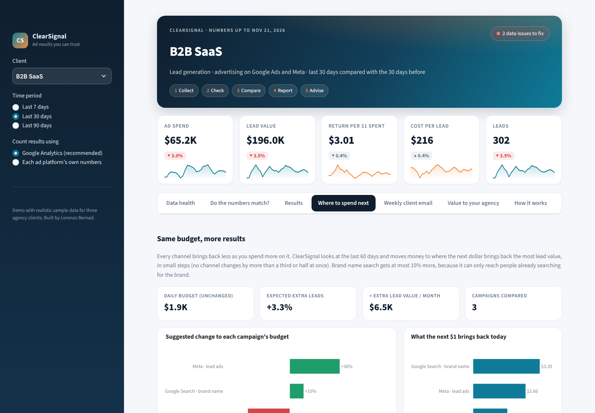

# ClearSignal · ad results you can trust

[](https://github.com/lmsbernad-blip/clearsignal/actions/workflows/ci.yml)

**ClearSignal helps an ad agency take over a client's reporting fast: it collects the data, checks it every morning, explains why ad platforms and Google Analytics disagree, and turns the numbers into budget advice and a weekly client email.**

_Under the hood: a repeatable data onboarding kit (SQL + Python + Streamlit + Claude)._

**Live demo:** _[paste your Streamlit Cloud link here]_


| Reconciliation | Budget optimizer | Agency ROI |
|---|---|---|
|  |  |  |

## Why this exists

When an agency onboards a client, the first weeks go to the same problems every time: a connector double-loads a day, cost arrives in micros, a campaign goes live without UTMs, Meta and GA4 disagree by 40%. Until those are found, every dashboard is wrong.

This kit makes onboarding the same five steps for every client, so an analyst produces trustworthy reporting in days instead of weeks:

| Step | What it does | Where |
|---|---|---|
| **1. Connect** | Lands Google Ads, Meta Ads and GA4 exports (Supermetrics / Improvado style) in DuckDB, renamed to one vocabulary | `sql/01_staging.sql` |
| **2. Validate** | Eight SQL checks: duplicates, cost in micros, unmapped campaigns, missing UTMs, no GA4 match, tracking breaks, budget pacing, freshness | `sql/03_qa_checks.sql` |
| **3. Reconcile** | Platform vs GA4 conversions by campaign and week, each gap labeled *expected*, *within tolerance* or *fix* | `sql/04_reconciliation.sql` |
| **4. Report** | Dashboard: KPIs, campaign scorecard, pacing vs media plan, GA4 vs platform toggle | `app/` |
| **5. Recommend** | Budget optimizer (diminishing-returns curves, brand-search cap) and a Claude-drafted weekly client update | `app/analytics.py`, `app/prompts.py` |

Documentation an analyst owns is included: [onboarding checklist](docs/01_ONBOARDING_CHECKLIST.md), [KPI & data dictionary with reporting standards](docs/02_KPI_DATA_DICTIONARY.md), [a worked discrepancy investigation](docs/03_DISCREPANCY_CASE_STUDY.md) and [the Claude workflow](docs/04_CLAUDE_WORKFLOW.md).

## What it found in the demo onboarding

- **A "zero-lead" campaign that was actually one of the best:** a Meta retargeting campaign ran without UTMs, so GA4 filed its 104 leads under `facebook.com / referral`. Credited correctly, its ROAS goes from 0 to about 4.7. [Full investigation →](docs/03_DISCREPANCY_CASE_STUDY.md)
- **Double-counted spend:** a connector re-sync loaded two days of Meta data twice ($2,221 counted twice).
- **A pixel outage** hidden as a "performance drop": Meta purchases fell to zero for 3 days while GA4 kept recording sales.
- **Cost in micros** from a second Google Ads connector, an **unmapped holiday campaign**, and a client **on track to overspend its monthly plan by 66%**.
- **Expected gaps documented, not "fixed":** Meta reports about 40–50% more conversions than GA4 (7-day click / 1-day view), Google about 15%.

## Data

Client ad data is confidential, so the demo uses a **seeded simulation** of three agency clients (DTC e-commerce, B2B SaaS, home services) with exports in each platform's **native column names** (`cost_micros`, `purchases_7d_click_1d_view`, `sessionSourceMedium`, YYYYMMDD GA4 dates, Pacific vs Eastern time zones). See `scripts/generate_data.py` for the six planted problems. To use real data, replace the three CSVs in `data/raw/` with connector exports in the same shape.

## Run it

```powershell
python -m venv .venv
.venv\Scripts\Activate.ps1          # macOS/Linux: source .venv/bin/activate
pip install -r requirements.txt
python scripts/generate_data.py     # demo exports
python scripts/build_warehouse.py   # runs sql/01-04 into data/warehouse.duckdb
streamlit run app/streamlit_app.py
```

## Structure

```
data/raw/            Google Ads, Meta Ads, GA4 exports (connector-style)
data/seeds/          campaign mapping, media plan, client settings (maintained by the analyst)
sql/                 01 staging → 02 model → 03 QA checks → 04 reconciliation
scripts/             generate demo data, build warehouse, draft client note with Claude
app/                 Streamlit dashboard, analytics, prompt templates
docs/                checklist, data dictionary, case study, Claude workflow
```

## Next steps

- Swap the CSVs for live Improvado / Supermetrics feeds into BigQuery or Snowflake; the SQL ports with small changes
- Post the morning QA table to Slack
- Add CTV and programmatic (impressions, completion rate, reach) to the same model
- Validate optimizer recommendations with geo holdout tests

Built by **Lorenzo Bernad** · [LinkedIn](https://www.linkedin.com/in/lorenzo-bernad-a8a8831a1)
