# ClearSignal: architecture

## 1. Overview

ClearSignal is a small batch pipeline plus a read-only dashboard.

1. **Build (offline):** `scripts/build_warehouse.py` runs the SQL files in `sql/` in order. They load the CSV exports and seeds into a single DuckDB file, `data/warehouse.duckdb`. `app/warehouse.py` passes each input to the SQL as an absolute path and builds into a temporary file, which replaces the warehouse only once every step has succeeded. Staging is stored as tables, so the finished warehouse never needs the CSVs again.
2. **Serve:** `app/streamlit_app.py` opens that file **read-only**, does the light analytics in Python (`app/analytics.py`) and draws the pages (`app/ui.py`).
3. **Draft (optional):** `app/prompts.py` turns the week's facts into a prompt. The app shows the prompt and lets the user download it; `scripts/draft_client_note.py` sends it to Claude when an API key is set.

Two kinds of check protect the numbers. **Input contracts** (`app/contracts.py`) run before any SQL and reject files that would break the build or skew results: missing columns, unparseable values, out-of-range dates, negative spend, impressions or clicks, non-USD currency. **Data tests** (`sql/05_data_tests.sql`) run after the build and catch bugs in the pipeline itself. QA checks (`03`) are different: they find problems in the *client's* data and report them, without stopping the build.

There is no server-side state other than the DuckDB file, and nothing is written back to ad platforms.

## 2. Data flow

```mermaid
flowchart LR
  subgraph SRC["Inputs (CSV)"]
    direction TB
    GA["data/raw/google_ads_campaign_daily.csv<br/>Cost or cost_micros"]
    MA["data/raw/meta_ads_insights.csv<br/>re-sync duplicates possible"]
    G4["data/raw/ga4_traffic_acquisition.csv<br/>YYYYMMDD dates"]
    SD["data/seeds/<br/>campaign_mapping · media_plan · clients"]
  end
  GEN["scripts/generate_data.py<br/>seeded simulation"] -.writes.-> SRC

  subgraph WH["DuckDB · data/warehouse.duckdb"]
    direction TB
    S1["01 staging<br/>stg_google_ads · stg_meta_ads_raw · stg_ga4 · seed_*"]
    S2["02 model<br/>int_meta_ads (dedupe) → fct_ads_daily<br/>fct_ga4_paid_daily → mart_campaign_daily"]
    S3["03 QA checks<br/>qa_results (8 checks)"]
    S4["04 reconciliation<br/>reconciliation_weekly → reconciliation_summary"]
    S1 --> S2 --> S3
    S2 --> S4
    S1 --> S3
    S5["05 data tests<br/>data_test_results (9 tests)"]
    S3 --> S5
    S4 --> S5
  end
  S5 -- "any failure" --> STOP
  SRC --> VC{{"Input contracts<br/>app/contracts.py<br/>columns · types · dates · ≥ 0 · USD"}}
  VC -- pass --> S1
  VC -- fail --> STOP(["Build stops with a readable list<br/>old warehouse kept"])

  subgraph APP["Streamlit app (read-only)"]
    direction TB
    AN["analytics.py<br/>KPIs · channel table · response curves<br/>optimizer · weekly summary"]
    UI["streamlit_app.py + ui.py<br/>7 tabs"]
    PR["prompts.py<br/>client-note prompt"]
    AN --> UI
    AN --> PR --> UI
  end
  S2 -- mart_campaign_daily --> AN
  S3 -- qa_results --> UI
  S4 -- reconciliation_* --> UI

  PR --> DR["scripts/draft_client_note.py"]
  DR -- "prompt (facts only)" --> CL(["Claude API<br/>ANTHROPIC_API_KEY"])
  CL -- draft --> AM(["Account manager reviews<br/>and sends"])
  UI -- "download prompt / summary" --> AM
```

## 3. Tables

| Layer | Table / view | Grain | Purpose |
|---|---|---|---|
| Staging | `seed_campaign_mapping` | campaign | Analyst-maintained: campaign → client, type, `utm_campaign` |
| Staging | `seed_media_plan` | client × month | Planned monthly budget (pacing) |
| Staging | `seed_clients` | client | Business model, value per lead, GA4 time zone |
| Staging | `stg_google_ads` | source row | Renamed columns; spend from `Cost`, or from `cost_micros ÷ 1e6` (flagged) |
| Staging | `stg_meta_ads_raw` | source row | Renamed columns, **duplicates kept** so QA can see them; `synced_at` |
| Staging | `stg_ga4` | source row | Parsed dates; `source_medium`, `utm_campaign`, conversions, revenue |
| Model | `int_meta_ads` (view) | date × campaign | Meta deduplicated: latest `synced_at` wins |
| Model | `fct_ads_daily` | date × client × platform × campaign | Clean spend, delivery and platform conversions for both platforms |
| Model | `fct_ga4_paid_daily` | date × campaign | GA4 paid traffic matched to campaigns through `utm_campaign` |
| Model | `mart_campaign_daily` | date × campaign | Platform vs GA4 side by side, value, budget, business model; `UNMAPPED` type for missing mappings. **The app's main input.** |
| QA | `qa_results` | one row per failing check × object | The morning data-health list, written in plain language (title, detail, action, severity, spend at risk) |
| Reconciliation | `reconciliation_weekly` | week × campaign | Platform vs GA4 gap and status for the last 8 weeks |
| Reconciliation | `reconciliation_summary` | campaign | 8-week totals, typical status, weeks needing action |
| Data tests | `data_test_results` | test | Checks on the built warehouse: unique grain, spend preserved to the cent, no null keys, known campaign types and statuses. Any failure stops the build. |

The SQL holds the **rules that define trustworthy data** (dedupe, unit fixes, checks, statuses), so an analyst can review them as SQL. Python holds **presentation and modelling** (KPIs for a chosen window, response curves, optimizer, wording).

## 4. Where Claude fits

| Point | How | Guardrail |
|---|---|---|
| Weekly client email | `weekly_summary()` writes facts from the warehouse → `client_note_prompt()` adds open QA issues and a fixed structure → Claude (script) or a human pastes it into Claude (app download) | "Use only these facts"; a human always reviews before sending; the deployed app makes no API call |
| Analyst work (offline) | Drafting SQL checks, investigating gaps, documentation (see `04_CLAUDE_WORKFLOW.md`) | Every query is reviewed and tested before it goes into `sql/` |

The API key is read only from the environment (`ANTHROPIC_API_KEY`) and the model from `CLAUDE_MODEL`.

## 5. Runtime and deployment

- **Local:** `generate_data.py` → `build_warehouse.py` → `streamlit run app/streamlit_app.py`. If the warehouse file is missing, the app builds it on first load.
- **Streamlit Community Cloud:** the same entry point. The CSVs are committed and `warehouse.duckdb` is git-ignored, so the first session on a new container builds it (a few seconds).
- `@st.cache_data` caches the tables for each process.

## 6. Design review (Phase 2)

Found by reading the code and by testing the build and app with missing, empty, renamed-column and negative-value inputs.

### Findings

| # | Area | Finding | Evidence |
|---|---|---|---|
| D1 | Error handling | **A failed build leaves a half-built warehouse that the app then trusts.** The build writes in place, so a failure in step 2 leaves the step-1 tables in place. On the next start the app sees the file exists, skips the rebuild and crashes with `Table mart_campaign_daily does not exist`. | Tested: deleted the Meta CSV → build exits 1 but leaves 4 tables → app shows a raw DuckDB error |
| D2 | Error handling | Missing, empty or renamed-column files produce raw DuckDB errors (`IO Error`, `Candidate bindings: "column0"`). The app turns them into a `CalledProcessError` stack trace. | Tested all three cases |
| D3 | Validation | Bad values are accepted silently: a negative spend went straight into `fct_ads_daily` (`min(spend) = -835.6`) and the build exited 0. Currency is never checked. | Tested |
| D4 | Duplicated logic | **Pacing is calculated twice with different rules**: the SQL check uses an 85–110% band and the Results chart uses 90–110% (red only above 110%). Month-to-date maths is re-done in the app. | `03_qa_checks.sql:93` vs `streamlit_app.py:204-208` (gap G-02) |
| D5 | Coupling | The optimizer finds brand search by searching the **display label** for "brand name". Renaming the label in `FRIENDLY` would silently remove the 10% brand cap. It should use `campaign_type = 'Search - Brand'`. | `analytics.py:99` |
| D6 | Robustness | `optimize_budget` fails on an empty curve table (any client with under 20 usable days) and has a confusing `isinstance(max_mult, pd.Series)` branch. `weekly_summary` fails when no channel has value this week (`idxmax` on an empty table) and can print "$nan" CPA. `draft_client_note.py` with an unknown client name crashes. | Code reading (gap G-05) |
| D7 | Config | Thresholds live in 3 places: 20% match / 15–70% Meta band / 8 weeks (SQL); 85/110% / 25% High (SQL) and 90/110% (app); 0.7/1.5/1.10 guardrails, 60-day fit, 20-day minimum, b clipped to 0.2–0.95 (Python); the 60-day and +10% numbers are also typed into the explanation text. | grep of magic numbers |
| D8 | Config / paths | `ROOT` / `DB` are redefined in the app and in each script. SQL reads files by relative path through `set file_search_path = '<ROOT>'`, which is built with an f-string (it would break on a path containing `'`). | `streamlit_app.py:20`, `build_warehouse.py:6,10`, `draft_client_note.py:23` |
| D9 | Function size | `streamlit_app.py` is a 337-line script mixing data access, formatting (`usd`, `pct`), business maths (pacing, period windows, ROI calculator) and charts, so none of it can be unit-tested. | — |
| D10 | Efficiency | The optimizer (curve fit + 400-step greedy loop) runs twice on every rerun: once in "Where to spend next" and again in "Weekly client email". Uplift is computed in both the app and `weekly_summary`. | `streamlit_app.py:231,263` |
| D11 | Wording in SQL | Check text has hard-coded nouns ("Meta counted zero **sales**", "**leads** from Facebook", "Ad platform stopped counting sales") whatever the platform or business model. | `03_qa_checks.sql:56-64, 39-45` (gap G-08) |
| D12 | Concurrency | On Streamlit Cloud, two first visitors can both start the auto-build at the same time and collide on the DuckDB write lock. | Design reading |
| D13 | Naming | `channel` actually means "campaign-type label" (the Campaign summary groups by it); terse names `n`, `k`, `k0`, `cdf`, `ct` make the app hard to follow. `label_of` maps campaign → label across all clients. | — |
| D14 | Minor SQL | The `tracking_break` median subquery is matched on `campaign_name` only (not client and platform); `freshness` only compares against the GA4 max date. Fine for today's data, but fragile. | `03_qa_checks.sql:69,101` |

### Proposed fixes, ranked by risk (highest first)

| Rank | Fix | Addresses | Effort | Changes app behaviour? |
|---|---|---|---|---|
| **1** | **Atomic build:** build into a temp file, run the data tests, then swap it in; delete the temp file on failure. The app checks the required tables exist, not just that the file exists. | D1, D12 | S | No (failures become safe) |
| **2** | **Friendly errors:** a small `load_warehouse()` guard in the app that catches build or read errors and shows `st.error` naming the file and the fix (run the two scripts); the build prints one readable line per problem. | D2 | S | Only on failure |
| **3** | **Input contracts** (Phase 5): check required columns, types, date range, no negative spend/impressions/clicks, USD only; fail fast before the SQL runs. | D3 | M | No |
| **4** | **One pacing rule:** the chart uses the same 85–110% band from config, and the SQL and the app read the same numbers. | D4 | S | Chart verdict for 85–90% pacing changes from "under budget" to "on track" (defect fix) |
| **5** | **Brand cap by campaign type**, not by label text; simplify the `max_mult` branch. | D5 | XS | No (same result today) |
| **6** | **Edge-case guards** in `optimize_budget` (empty input → empty plan; app shows "not enough history yet"), `weekly_summary` (no measurable channel / zero conversions → plain wording, never "nan") and `draft_client_note.py` (unknown client → list of valid names). | D6 | S | Only in edge cases |
| **7** | **`app/config.py`** (Phase 3.4): paths, match tolerance, pacing band, Meta band, optimizer guardrails, brand cap, fit window. The SQL thresholds are passed in as DuckDB variables (`set variable`) so there is one source. | D7, D8 | M | No |
| **8** | **Compute the plan once per rerun** (cached with `st.cache_data` by client) and reuse it in both tabs. | D10 | XS | No (faster) |
| **9** | **Business-aware wording in checks:** say "conversions"/"results" or choose sale vs lead from `business_model`, and name the platform from the data. | D11 | S | Wording only, in these two checks |
| **10** | **Small refactor of the app:** move `usd`/`pct`, pacing and period-window maths into `analytics.py` (testable); rename terse variables. No layout or wording change. | D9, D13 | M | No |
| 11 | Tighten the `tracking_break` median to client + platform + campaign; compute freshness per source against the overall max date. | D14 | XS | No (same result today) |

Recommendation: **1–8** are worth doing before release; 9 and 10 improve quality but touch wording and structure; 11 is optional.

## 7. Threat model

Added in Phase 6.
